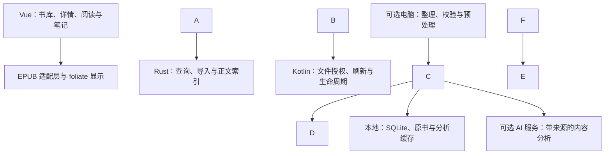

# 基于 LightRead 的 NoteX3 Pro 个人电子书阅读器：开发评估与功能规划

日期：2026-10-16  
使用范围：个人使用、4000 多本电子书、EPUB 为主、本地书库、标签分类、多语言阅读及必要的 AI 内容分析。

## 1\. 核心判断

**可以基于 LightRead 开发，但需要把它改造成针对 NoteX3 Pro 的专用阅读版本。首版的投入应集中在书库、排版和设备体验。**

LightRead 已有可复用的 EPUB 阅读、SQLite 存储、标签、书单、批注、AI 接口和“点睛阅读”实现。需要补齐的是：4000 本书的高效组织与浏览、可靠的 Android 目录接入、按内容语言选择排版方案、墨水屏刷新和休眠处理，以及能够回到书中证据的 AI 分析。

4000 本书的元数据规模并不要求复杂的服务器。性能取决于是否把原书、封面和全文处理带进启动与翻页过程。**阅读器必须完全离线可用；电脑和 AI 服务作为可选增强。**

建议顺序：

1. 真机验证 EPUB 引擎、文件访问、位置恢复和刷新。
2. 完成标签书库、详情、元数据导入、分页与封面缓存。
3. 完成中文和英文排版，以及语言自动识别和逐书覆盖。
4. 复用章节标注与摘要，补充带出处的选段解读和本书问答。
5. 依据实际使用，再做专题跨书检索、更多语言和电脑辅助整理。

### 1.1 证据范围与未验证事项

本报告检出了 LightRead 源码，并检查了书库存储、导入、书库视图、阅读样式、Android Activity、AI 对话及点睛引擎。核查快照为：

* 仓库：[https://github.com/yzfly/LightRead](https://github.com/yzfly/LightRead)
* 提交：`cd53268f9aa5891c4eb8d73f6126ac6570d12dea`
* 该快照 `package.json` / Tauri 配置版本：`1.15.0`
* 核查时间：2026-10-16。后续上游变化需重新比对。

**本报告没有在你的 NoteX3 Pro 上安装或测量，也没有抽检你的 4000 本电子书。** 固件、Android System WebView、可用存储、书籍语言分布、平均体积和源文件质量均未实测。文中的排版参数、性能指标和工作量是设计建议或验收目标，不能视为当前软件实测能力。

未明确的阅读语言暂按简体中文、繁体中文和英文规划。日文、阿拉伯文及其他语言应按真实书库占比扩展。

## 2\. LightRead 已有什么，具体差在哪里

### 2.1 可复用能力与改造边界

|能力|源码核查情况|面向你的改造判断|
|-|-|-|
|应用框架|Tauri 2、Vue 3、TypeScript、Rust；存在 Android arm64 构建流程|保留框架，增加少量 Kotlin 原生能力；Android 实验版本仍需真机验证|
|EPUB 阅读|使用 foliate-js；分页器已存在 LightRead 自有 fork|保留并封装接口，先验证中文/英文 EPUB；升级时同时检查自有分页器补丁|
|书库存储|Tauri 环境走 SQLite + 书籍文件；Web 环境走 Dexie/IndexedDB|已有 SQLite，无需重新引入数据库；重点改查询接口、标签关系和文件访问|
|标签与书单|已有单标签筛选、标签重命名、批量加标签、书单成员关系|扩展为多维标签、组合筛选、智能书架与受控词表|
|书库列表|`listBooks()` 全量读取；前端筛选排序；`v-for` 渲染筛选结果|墨水屏优先分页；避免一次渲染全部书卡|
|封面|刷新书库后遍历全部有封面的书，请求并缓存 Object URL|改为可见页加载、小尺寸缩略图、有限并发和 LRU 回收|
|EPUB 元数据|导入提取书名、作者、简介、语言、封面；标签初始为 `\[]`|补取 `dc:subject`、ISBN、译者、出版社、丛书等，保留来源|
|Android 目录导入|`canPickFolder()` 对移动端直接返回 false|需要原生 SAF 目录选择、持久 URI 权限和分批扫描|
|阅读参数|已有字号、行距、字体、字距、主题、分栏及翻页/滚动等|扩展为按语言、体例和单书保存的排版配置|
|墨水屏样式|已有黑白、较高字重、去动画、灰度图像、下划线标记|这是可复用的起点；仍需设备刷新、触控、休眠和整套 UI 改造|
|普通 AI 对话|系统提示带书名、作者、章节名，另带近期聊天；选段解读带选中文本|一般聊天尚不能证明读过正文，需要上下文构建与出处校验|
|点睛阅读|代码已有段句编号、分块、校验、关键词、术语、章节要义、缓存及小说处理|优先复用，补强跨章节证据、持久任务与分析覆盖范围|
|论文 Agent|`paperAgentRuntimeAvailable()` 明确排除移动端|不把桌面命令行 Agent 搬到阅读器；EPUB 分析复用 HTTP AI 路径|

代码证据见附录 A。项目 README 将 Android 列为实验版本。\[R1]

### 2.2 三个需要纠正的开发判断

**第一，已有 SQLite，不能把“大书库”简单归因于缺少原生数据库。** 当前主要负担来自全量查询、全量封面请求、前端排序和 DOM 数量。4000 条简单书目信息可以容纳在内存；是否进一步取消全量元数据缓存，应根据测量决定。全量封面和全量书卡应优先改。

**第二，已有墨水屏模式，不应重复开发黑白 CSS。** 更值得做的是：竖屏默认单页翻页、系统刷新协调、去掉整套界面的动态效果、按页呈现 AI 结果，以及处理合盖、休眠和进程被回收后的恢复。

**第三，已有 AI 预分析，不应另写一套同样的章节摘要。** 点睛引擎已把正文切成可定位段句并处理结果。应在这些能力之上增加可靠的本书问答、证据引用和分析管理。部分设计文档仍保留“设计稿”或阶段规划说明，功能状态需以当前代码和运行验证共同判断。

## 3\. 把“出版物级阅读体验”变成可验收的要求

出版物级体验至少包含五项：

|层面|应达到的结果|典型反例|
|-|-|-|
|内容结构|章节、引文、诗歌、注释、图表、强调关系得到保留|统一套样式后，诗歌缩进、表格和注释全部被破坏|
|文字排版|匹配语言的字体、断行、段落与标点规则|英文强制字间拉伸、中文逗号顶到行首|
|页面完整性|无缺行、重行、截字、图表遮挡，标题与正文关系合理|字号改变后出现空白页，跨章漏掉首段|
|设备交互|翻页清晰、残影可控、选字稳定、休眠后原位恢复|弹窗关闭留下残影，误触翻页导致选字丢失|
|内容定位|引用、批注、搜索和阅读位置保持稳定|改了字体以后批注落到另一段，AI 给出不存在的页码|

**源文件质量必须纳入产品范围。** 阅读器无法仅凭换字体把扫描型 EPUB、错误 OCR、图片化正文或严重破损的 XHTML 自动变成精校出版物。需要识别、提示并提供处理路径。

### 3.1 三种显示模式

1. **出版原貌**：尽量保留出版方字体与版式；适合精制 EPUB、诗集、图文书和特殊编排。
2. **自动优化**：按语言和体例优化正文，保留标题、诗歌、引文、表格、代码、脚注和插图的语义区别。作为一般可重排 EPUB 的默认模式。
3. **兼容修复**：针对正文过小、低对比、固定宽度、错误段距等问题，按项覆盖；保留预览与撤销。

固定版式 EPUB 应默认保持原版，提供缩放和图像查看。不能因为检测到中文就统一改成正文重排。\[R2]

## 4\. 4000 本书的书库：分类、列表、详情和整理

### 4.1 信息结构

保留三个主要入口即可：书库、继续阅读、笔记。设置放进菜单。首页优先呈现正在读的几本书和常用标签，不展示数千个封面。

书库路径：**标签分类 → 组合筛选后的书籍列表 → 书籍详情 → 开始/继续阅读。** 列表提供直接继续阅读的快捷操作。返回时恢复筛选、排序与页码。

墨水屏默认使用文字列表配小封面；封面网格作为可选视图。建议每页先按 10–14 行试排，实际数量由字号和触控测试确定。应有上一页/下一页、当前位置和跳页，避免必须长距离滚动。

### 4.2 用多维标签表达分类

不要把主题、语言、阅读状态和格式混进同一个自由文本标签池。

|维度|示例|建议管理方式|
|-|-|-|
|主题分类|医疗数字化、人工智能、经济学、历史、文学|用户标签；允许父子关系，初版控制在两级|
|文体/体例|专著、小说、论文集、工具书、诗歌|字段或受控标签；允许人工修正|
|阅读状态|未读、在读、已读、搁置|独立状态字段；不要只用进度百分比推断“已读”|
|阅读计划|本月、待精读、参考资料|用户标签或书单|
|语言|简体中文、繁体中文、英语、日语|元数据 + 检测结果 + 人工覆盖|
|版本与系列|原著、译本、第二版、某丛书第 3 本|单独保存版本、译者、系列和顺序|
|文件情况|EPUB、固定版式、缺目录、待校验|系统字段或质量状态|

标签需要：计数、合并、重命名、别名、批量增删和撤销。保留原始主题词，同时建立规范标签。手工确认的标签优先于 AI 建议，后续自动分析不得覆盖。

筛选规则建议：同一维度内默认 OR，不同维度间默认 AND，允许排除。示例：

`（医疗数字化 OR 人工智能） AND 未读 AND 中文 AND 非小说`

可保存为“医疗 AI 待读”。书架保存查询条件，导入新书后自动更新结果。标签计数按当前筛选语境计算，并避免一本书多标签造成重复计数。

### 4.3 书籍列表

默认展示小封面、书名、作者/译者、少量主要标签、阅读状态和最近阅读时间。支持书名、作者、加入时间、最近阅读、系列顺序排序；复杂字段可以留在详情页。

必要操作：全文库标题搜索、作者搜索、按标签筛选、缺失元数据筛选、多选批量整理、书单收录、重复版本提示。输入搜索可轻度防抖，避免每输入一个字都刷新整屏。

不要用仅鼠标悬停才出现的按钮。点击目标需足够大，选字、翻页和长按多选要有明确冲突处理。

### 4.4 书籍详情

|内容区|必要字段与动作|
|-|-|
|基本信息|封面、书名、副标题、作者、译者、出版社、出版年、ISBN（如有）、语言|
|内容导航|简介、分层目录；目录项可直接进入正文|
|分类|主题标签、系列、所属书单；允许编辑与批量处理|
|阅读|开始/继续阅读、状态、最近阅读、批注数、书签数|
|文件与质量|格式、大小、原文件名、版本、导入来源、缺目录/缺语言/固定版式等提示|
|显示方案|当前排版配置、自动选择依据、本书覆盖项、一键恢复自动|
|AI 分析|已分析章节及范围、结果时间、模型、可离线查看状态、继续分析/重新分析|

书籍简介、出版社或 ISBN 缺失时，保留“未知”。AI 可以提出候选和出处，不能把猜测直接写成书目事实。

### 4.5 导入与元数据

优先级建议：用户已确认字段 > 经过用户选择的外部书目/Calibre 字段 > EPUB 内嵌元数据 > 文件名回退。保存每个字段的来源，允许恢复原值。

导入时新增：

* EPUB `dc:subject` 与 Calibre 标签映射；原始字符串与规范标签分开保存。
* 多作者、译者、出版社、出版日期、ISBN、系列及序号。
* 语言声明及检测结果；疑似错误声明进入待确认队列。
* 文件 SHA-256、文件大小、内容版本和导入时间。
* 结构检查：目录、正文资源、字体、固定版式、图片化正文、明显破损。

\*\*去重分两层：\*\*相同文件 hash 可直接提示重复导入；相似书名/作者/ISBN 只能提示疑似同书。不同译本、修订版、插图版不能自动合并。重新导入相同文件应沿用原书身份、标签和批注。

### 4.6 Android 批量导入必须单独做

当前移动端缺少目录导入入口。建议用 Kotlin 接入 `ACTION\_OPEN\_DOCUMENT\_TREE`，持久保存用户授权的目录 URI，在原生层分批遍历。Android 的目录权限和普通文件路径不同，不能把 `content://` 当成本地绝对路径交给 Rust。\[R3]

默认推荐托管导入：从授权目录复制到应用管理的书库，导入前计算空间预算。若原书本来已在设备上，复制期间可能出现双份占用。空间不足时，可选择授权目录直读模式，但应明确提示目录移动、授权撤销和卸载后的恢复路径。

源文件通过原生流读取；需要随机访问的 EPUB 可以建立受限、可回收的本地暂存。不能为了打开一本大书把数百 MB 的字节数组反复穿过 JS/Rust 桥。

批量任务必须保存清单和进度，支持暂停、重启恢复和失败重试。初次按需解析封面；全文提取、质量检查和 AI 分析另排队。日常启动只读取索引，增量扫描由用户触发或在明确的维护时段执行。

当前文件夹扫描还有 5000 文件的保护阈值，扫描计数包含非书籍文件。若将来复用桌面扫描逻辑，4000 多本书附带封面和 sidecar 文件时可能提前触发上限，应改为可配置、可继续扫描，并明确显示跳过和截断情况。

### 4.7 性能与存储设计

* SQLite 分页查询，只返回列表需要的字段；说明、目录等在详情页按需读取。
* 标签采用 `tags` / `book\_tags` 关系表，支持索引、组合筛选和统计；迁移期间保留兼容转换。
* 封面生成小尺寸缩略图，只加载当前页和少量预取页，限制并发并回收 Object URL。
* 原书保存在文件系统；全文和向量索引使用独立、可重建目录，不随页面全部载入。
* 批量导入、标签合并使用事务或可恢复任务，避免中途失败留下不一致状态。
* 翻页时不做文件 hash、书库扫描、全文分词或模型请求等待。

容量应先盘点。举例：4000 × 6 MB = 24 GB；4000 × 12 MB = 48 GB。这是情景计算，不是你的书库实测。再加原书副本、系统占用、索引和缓存，可能比“4000 本”这个数量本身更限制设备。

缩略图若平均 40 KB，4000 本约 160 MB；这类磁盘占用可以接受，全部解码后常驻内存则没有必要。

## 5\. 自动排版：语言、体例、字体与个人偏好共同决定

### 5.1 自动选择机制

建议新增 `LanguageResolver` 和 `TypographyResolver`，输出可解释的显示配置。

1. 从 OPF `dc:language`、XHTML 的 `lang` / `xml:lang` 以及书籍排版属性取值。
2. 排除封面、版权、目录等干扰，抽样正文多个位置，校验声明是否可信。
3. 区分书籍主语言、章节语言与段落内嵌语言；简繁汉字、日文汉字不能只靠“出现汉字”判断。
4. 结合体例选择中文正文、英文正文、诗歌、技术文档等模板。
5. 叠加用户的语言偏好与单书覆盖，并受设备实际能力约束。

**人工单书设置始终保留。** 对具体段落，可信的局部语言声明优先于全书推断；对整本书的初始模板，优先使用已确认元数据，其次使用内容检测。低置信度时保持保守模板并允许一键修正。

不使用大模型决定日常字体和语言。语言选择需要离线、确定、可缓存，也不应因网络状态改变显示。

打开书或跨到语言明显不同的章节时完成必要判断；不要逐句更换整本书配置。页面显示后不要自动更换字体造成跳页。中英混排通常只需匹配字体回退和局部语言规则。

### 5.2 初始排版配置

以下是启动调校用的建议值，不是出版规范或真机最优值。

|内容|字体方向|行距起点|段落与断行|特别处理|
|-|-|-|-|-|
|简体中文一般正文|思源宋体 SC / Noto Serif SC 类字体；标题用适度黑体|1.55–1.75|一般正文首行缩进 2em；适度段距；两端对齐，处理行首行尾禁则|避免英文词、数字单位及成对标点被不当拆分|
|繁体中文一般正文|符合地区字形的 TC/HK 字体|1.55–1.80|保留引号与标点习惯；尊重已有横排/竖排|不自动进行简繁转换，不由“繁体”推断必须竖排|
|英文一般正文|Literata 或同类长文衬线字体，含真正 italic/bold|1.40–1.60|默认左齐右不齐；首段与后续段区分；验证断词后再开放两端对齐|断词取决于语言和 WebView 的实际词典支持|
|中英混排|中文字体 + 匹配的西文字体回退|随正文模板|保留英文词与术语整体，检查基线和数字|先使用字体与 CSS 能力，不往原文插空格或拆文字节点|
|诗歌、戏剧、引文|优先保留原字体与结构|按原书|保留换行、缩进与分节，不统一强制缩进/对齐|用户可单独调字号和留白|
|技术、数学类|正文字体 + 等宽字体 + 符号回退|按内容|保留代码空格、列表层级、公式和表格|公式/大表格提供独立查看与缩放|
|日文（按书库需求加入）|JP 字形的明朝体/黑体|独立调校|保留 ruby、禁则和书籍指定方向|不能套用中文模板后宣称完整支持|
|RTL 语言（按需求加入）|覆盖对应文字的字体|独立调校|同时验证文本方向和翻页方向|保守保留出版方设置，单独建立测试集|

中文初期可把正文行长放在约 28–36 个汉字的调校范围；英文可从约 55–70 个字符的行长尝试。行长、字号和边距一起测试，不作为死值。

**300 PPI 面板不能直接换算为 CSS 字号。** 实际视觉大小还受 Android density、WebView 缩放和页面视口影响。应先校准真机字号，再看每行字数与阅读距离。字体测试可先固定两三套候选，避免提供大量质量参差的字体选项。

思源宋体提供多地区字形；Literata 面向长文数字阅读并提供 roman/italic。\[R4]\[R5] 字体文件应包含实际需要的字形与字重，缺字回退需要测试，不能仅配置一个 Android 上未安装的字体名称。

### 5.3 “出版级”最需要补的细节

1. **标点与断行**：行首不出现不适合起行的标点，行尾不留下开引号；省略号、破折号、数字单位等规则纳入样本。W3C 中文排版需求提供了明确的规则基础。\[R6]
2. **层级与段落**：正文、标题、引文、题记、图注、脚注、列表保持区别。开篇首段、标题后首段、连续正文可以有不同缩进规则。
3. **分页完整性**：标题尽量与后文同页；减少孤行；检查跨章、跨栏、字号变化后的缺行和重复。CSS 的 `widows`、`orphans`、`break-\*` 在目标 WebView 中必须实测，不能只凭声明认为生效。
4. **脚注**：识别正确标记的 EPUB 注释；提供弹出阅读、较长注释分页和明确返回。对普通链接形式的注释做保守兼容，不把所有章节链接都识别为脚注。
5. **图表**：点图可全屏查看、缩放和恢复位置；大表格独立查看，避免压成无法辨认的字体。保留原图，灰阶增强是可撤销的显示选项。
6. **字体与字重**：保留真正斜体、粗体和特殊字体；中文正文的墨色通过实际字重与设备显示调校共同决定。当前统一增重到 500 可作为对照组，不应认定对所有字体最优。
7. **页码与定位**：有出版方 `page-list` 时显示原书页码；没有时显示章节、阅读进度和动态页码，并区分两者。AI 引用不能编造纸书页码。

`line-break`、`hyphens`、`text-spacing`、悬挂标点等能力要逐项验证。在 WebView 无法稳定提供的情况下给出保守降级。若目标是与纸质书逐页一致，应选择对应的固定版式资源；可重排 EPUB 的目标是保持内容完整与阅读质量。

### 5.4 位置与排版的稳定性

批注不能只保存“当前第 183 页”。建议保存：

`book\_id + file\_hash/edition\_id + spine\_href + EPUB CFI + text quote + prefix/suffix`

其中 CFI 为主要定位，文本引用及前后文作为校验或回退。换字体、调字号通常不应改变原文节点结构。自动优化优先通过样式实现，避免为中英间距或 AI 标注拆分、插入文本节点。

原文件修复、重新切章或换版本可能导致 CFI 失效。应作为内容版本变化处理，按文本锚点协助迁移；匹配不确定时保留待确认状态，禁止悄悄迁到另一段。

## 6\. NoteX3 Pro：墨水屏交互与设备适配

### 6.1 墨水屏专用默认值

|项目|建议行为|
|-|-|
|阅读方式|竖屏单栏、按页翻页；关闭当前可选的竖屏自动连续滚动|
|翻页|瞬时切换，去掉滑动、卷页和淡入；预取下一页所需内容|
|页面配色|纯白底、清晰黑字；注释、选中和状态不能只靠颜色区分|
|工具栏|点击中部出现，打开和关闭时不使用透明渐变；固定清晰的点击区域|
|书库|默认列表分页；减少阴影、毛玻璃、骨架闪动和动态占位|
|AI 输出|请求可以流式接收，显示按段或整页更新；取消逐 token 跳动和持续自动滚动|
|状态变化|页面静止时不反复更新时间、进度小动画和光标；状态仅在必要事件后更新|
|休眠|沉浸阅读保留系统自动休眠；常亮作为独立可选设置|
|输入|长按选字时锁定翻页；支持左右手触控区域；有外接翻页器时可映射按键|
|图片|原图保留；灰阶增强按需开启，线图与照片分别验证|

对本项目可以在构建配置中隐藏打字机、歌词、背景声、复杂在线书源、论文 Agent 等入口。避免只隐藏界面却仍在后台注册计时器、预取或发送无关请求。以功能开关和模块边界裁剪，减少长期维护冲突。

### 6.2 刷新策略需要原生桥接与降级

BOOX 官方 SDK 示例公开了屏幕刷新、刷新模式、前光和 WebView 相关能力。\[R7] 这说明存在可用的集成方向，**不能据此保证当前 SDK 在你的固件上对 Tauri WebView 全部有效。**

建议封装 `EinkAdapter`：

* 启动时检测厂商、型号和可用能力，记录实际固件与 WebView 信息。
* 正文使用清晰的文字阅读模式；图片、目录和大面积界面变化使用相应刷新处理。
* 保留用户手动“清除残影”动作。
* 可从每 6–12 次普通翻页一次全刷开始调校，允许用户更改或关闭定期全刷。
* 弹窗关闭、图像退出等情况按实际残影决定刷新，避免每个小操作都全屏闪烁。
* SDK 不可用时，回退到系统的应用优化设置和无动画分页，不依赖 root 或修改系统刷新文件。

刷新参数只能通过真机对比确定。若系统已经管理该应用的刷新策略，应用层需避免重复强制刷新。

### 6.3 稳定性比视觉装饰优先

阅读位置需要在翻页后以小幅延迟落盘，并在切到后台、系统休眠、退出时尽可能完成提交。不要仅依赖 WebView 的卸载事件。需验证进程直接被杀时的丢失边界；突发掉电不能只靠生命周期回调补救。

长时间阅读时应保持任务队列安静。导入、生成缩略图、全文索引和 AI 批处理支持暂停。断网时能继续阅读、查离线词典、浏览已缓存分析和管理标签。

升级使用稳定包名与签名，测试数据库迁移。备份文件放在应用之外，并验证恢复书籍、标签、进度、批注和单书排版设置。不能把“导出成功”提示当作文件确实落盘的证明。

## 7\. 必要的 AI：围绕具体阅读任务增加能力

### 7.1 首版保留的五类能力

|能力|使用方式与输出|依据及约束|优先级|
|-|-|-|-|
|选段解释/翻译|长按文字，选择释义、背景、翻译；短卡片显示结果|发送选段、有限上下文和章节信息；允许回看原文；先尝试离线词典|P1|
|章节要义|段落要点、关键概念、论证关系和少量重要语句|复用点睛引擎；每个主要观点能跳回原段；标记分析范围|P1|
|本书问答|例如“作者如何区分效率和公平？”|先检索本书正文，再生成答案；引用可点击；找不到时明确说明|P1|
|阅读回顾|再次打开书时回顾已读章节和自己的批注|小说只取已读内容；可以一键关闭；不默认占正文空间|P1|
|标签建议|基于简介、目录、部分正文提出主题/体例标签|从用户已有词表优先选择；人工确认后写入；保存建议依据|P1|

P0 仍是离线阅读和标签书库。AI 是首个完整版本的必要增强，但不能成为翻页、语言选择或元数据展示的前置依赖。

后期再加：选定专题的跨书比较、概念索引、围绕个人批注形成的阅读笔记。全库自动写书评、持续自动推荐和知识图谱可视化暂不进入首版。

### 7.2 普通聊天、章节预分析与本书问答要接起来

当前普通聊天入口和点睛引擎是两条能力路径：前者以聊天提示为主，后者已处理真实段句。需要统一正文抽取、定位和分析记录，避免用户在“本书问答”里得到仅凭模型既有知识生成的回答。

建议处理过程：

1. 解析 EPUB spine，按实际阅读顺序抽取正文，保留章节、标题、段落、表格和注释关系。
2. 为每段保留稳定来源信息和文本校验信息，不靠模型生成页码。
3. 章节摘要直接处理该章或分段后的汇总；大章采用分层摘要，并记录已覆盖哪些段落。
4. 本书问答先做关键词检索，必要时增加语义检索，再取相邻上下文供模型回答。
5. 模型返回正文及来源段落 ID。客户端验证 ID 和引文，再关联回原书位置。
6. 输出区分“书中陈述”“基于书中材料的推断”“补充背景”。背景信息若未外部核验，不冒充书中证据。

找到了出处，不代表答案一定准确。还需要校验引用与答案是否相关、是否遗漏反例和限定条件。复杂问答可展示多个相邻证据。

### 7.3 分析不能抹平书籍差异

|书籍类型|建议分析输出|
|-|-|
|非虚构、社科、管理|核心主张、前提、证据、推理步骤、限制与反例|
|专业/技术书|概念定义、适用条件、术语表、方法步骤、跨章节依赖|
|小说|已读人物关系、此前情节回顾、典故解释、叙事线索；默认不展开后续情节|
|历史与传记|人物、事件、时间线；区分作者判断与叙述事实|
|诗歌和古典文本|词句、典故、版本与译法说明；保留原文与注释对应|

**防剧透必须限制可送入模型的文本范围。** 只在提示词中写“不要剧透”不够。默认限制到当前已读位置；模型可能从预训练知识知道结局，因此小说解释仍应保守，只做所给材料支持的说明。整本分析由用户主动开启。

### 7.4 4000 本书分层处理，控制成本和等待

|处理层级|范围|默认执行位置/时机|
|-|-|-|
|L0 元数据索引|全部书籍的书名、作者、主题、语言、目录基本信息|本机增量建立；可在电脑预处理|
|L1 主题建议|简介、目录、少量抽样正文|用户选择后批处理；AI 建议待确认|
|L2 深度分析|当前阅读书籍、选定章节|阅读器请求、模型服务处理；结果本地缓存|
|L3 专题跨书|用户明确选定的一组书|可选电脑/内网服务，显示所包含的版本和索引范围|

不建议导入后立即把全部书籍交给模型。也不建议先把所有正文都建向量，再证明有使用价值。

量级示例：假设每本 20 万汉字、每块 800 字，4000 本约为 100 万文本块；每块 1024 维、float32，**裸向量约 4.096 GB**，尚未计算文本、元数据、索引结构和重叠块。该假设不代表实际书库，但足以说明全库向量化应该单独评估，而非默认驻留在阅读器。

跨书需求出现前，先做好书名/作者/标签搜索、目录检索与本书全文搜索。中文分词需显式设计；FTS5 默认分词不应被当作完善中文方案。trigram 也不能独立覆盖中文两字查询：官方文档说明少于 3 个 Unicode 字符的全文查询不匹配，需要分词、二元索引或短查询回退策略。\[R8]

### 7.5 AI 工程要求

* 复用现有 OpenAI 兼容 HTTP 接口；模型地址可指向家中电脑、内网服务器或用户选择的云服务。
* 阅读器不要求安装 Python、Ollama 或命令行 Agent。本机处理解析、检索和展示，生成式推理由外部服务完成；离线模型作为后续实测选项。
* 分析任务可取消、超时、重试、断网恢复；阅读操作优先于批处理。
* 缓存键至少包含文件内容版本、章节/段落 hash、分析类型、模型、提示词版本、输出语言和已读范围。
* 将可重建 AI 缓存与用户笔记分开；用户采纳的结果成为用户笔记后，需要进入可靠备份。
* 显示已分析范围与未分析范围。部分章节摘要不能呈现为“全书分析完成”。
* 保存来源、模型和时间；模型升级后不自动重跑全部书籍。
* 云服务只接收用户所请求范围的必要内容，首次设置说明传输范围；密钥使用 Android 安全存储，日志不记录密钥与整段正文。
* 书籍内容是待分析材料，不能作为要求执行系统命令、上传书库或修改文件的指令。
* 输出优先短卡片、分段与分页；“添加为我的笔记”由用户主动操作。

## 8\. 推荐的技术实现

### 8.1 保留现有框架，明确三端职责

|部分|职责|技术建议|
|-|-|-|
|阅读界面|标签、列表、详情、排版设置、批注及分析结果|保留 Vue 3 / TypeScript；针对墨水屏重做交互默认值|
|EPUB 显示|XHTML/CSS、分页、导航、CFI 与文字选择|先保留 foliate-js 和现有 fork，新增边界明确的适配层|
|本机业务|SQLite 查询、标签、文件 hash、导入队列、文本索引、备份|复用 Rust / SQLite；重任务离开 WebView 主线程|
|Android 能力|SAF、生命周期、刷新、系统栏、可选按键和前光接口|少量 Kotlin Tauri 插件；厂商 SDK 可探测、可降级|
|可选电脑工具|Calibre 元数据映射、大规模检查、封面/文本预处理|优先复用桌面 LightRead 或小型 Python 脚本；不强制再建复杂桌面产品|
|可选模型服务|生成、向量与重排等计算|兼容 HTTP API；不绑定一种模型或某个免费通道|

推荐的关系是：

图表示职责划分，不要求立即重写现有 AI 网络通路。实际改造可先由 TypeScript 复用接口，再把耗时与需要原生权限的任务移到对应层。

### 8.2 建议新增或拆分的模块

|模块|作用|主要依赖|
|-|-|-|
|`LibraryQueryService`|分页、排序、组合标签、结果计数|扩展 `LibraryStorage`|
|`MetadataExtractor`|完整书目、来源、subject/Calibre 映射|现有 importer|
|`ImportJobService`|持久任务、流式复制、去重与错误重试|Rust 文件层 + Kotlin SAF|
|`ThumbnailService`|小封面、可见范围预取、缓存回收|文件系统与图片解码|
|`LanguageResolver`|元数据与内容检测，保留人工覆盖|原始 EPUB 语言信息|
|`TypographyResolver`|语言/体例模板、单书配置、设备限制|现有 `readerTheme`、阅读参数|
|`EpubAdapter`|将打开、导航、定位、取文、批注接口与视图解耦|foliate 与自有 paginator|
|`EinkAdapter`|刷新策略、能力探测、降级|Kotlin / BOOX SDK|
|`ContentIndexService`|按章节抽取与检索，维护可回查锚点|原文件与内容版本|
|`ReadingAnalysisService`|串联点睛、摘要、问答、缓存和任务|现有点睛引擎、AI HTTP|

不必同时建设完整插件平台。现有 `ReaderView.vue` 约 4675 行、`LibraryView.vue` 约 1805 行，继续堆叠功能会增加回归范围。应先拆出查询、排版解析和分析上下文这几项变化频繁的职责。

### 8.3 最小数据模型

|表/记录|关键内容|
|-|-|
|`books`|稳定 book\_id、书目字段、阅读状态、版本与元数据来源|
|`book\_files`|文件 hash、URI/托管路径、大小、内容版本、可用状态|
|`tags` / `book\_tags`|规范名称、层级、别名、来源、人工确认状态与多对多关系|
|`collections`|手工书单和保存的查询条件，保持两种类型可区分|
|`reader\_profiles` / `book\_overrides`|各语言和体例模板、单书覆盖项、版本|
|`locations` / `annotations`|CFI、文本锚点、文件版本、用户笔记与书签|
|`content\_blocks` / 检索索引|章节、来源锚点、文本、分词和索引版本|
|`analysis\_jobs` / `analysis\_results`|分析范围、状态、版本、模型、证据和结果|
|`import\_jobs`|导入来源、待处理清单、已完成项、错误和恢复信息|

当前已有 books、annotations 和 booklists 等表，应采用可回滚迁移逐步扩展。book\_id 与文件路径分离，同一书文件移动不改变身份；不同版本必须能独立保存。

### 8.4 电脑与设备如何协同

电脑适合一次性整理大量标签和版本、校验 EPUB、生成缩略图。设备负责本地阅读、状态、批注与当前分析查看。4000 本书无需每次全部重新复制。

第一阶段可以只用 USB 传书和导入导出包，后续复用 WebDAV / OPDS 能力。传输的是书籍文件、书目清单与带版本的变更记录；不要在两个运行中的应用之间直接同步同一个 SQLite 文件。用户手工修改的标签不得被旧目录或 AI 结果覆盖，删除应有明确记录和恢复路径。

### 8.5 EPUB 内容与原生能力的边界

当前 Tauri 配置中 `csp` 为 `null`；foliate-js 上游明确要求使用适当 CSP 或其他方式阻止书籍脚本。\[R9] 这是需要在 PoC 中核验的实现风险，不能仅凭这一配置宣称存在已证实漏洞。

个人书库也应按普通内容文件处理：验证资源路径、限制解压大小，阻止不必要的书中脚本和远程资源，隔离 EPUB 文档与原生桥接。新增 SDK/文件操作应只接受受信应用界面的结构化命令。实际 CSP 需要兼容书内字体、图片和 blob 资源，不能随意贴一段策略后认为已完成隔离。

## 9\. 是否需要换阅读引擎

**首阶段保留 foliate。** 你的主要格式是 EPUB，LightRead 已有完整接入和修改过的分页器。没有真机阻断证据前直接换引擎，会丢掉已有定位、批注、搜索和点睛集成工作。

需要建立两个退出条件：

1. 在目标固件上，常见 EPUB 的分页、选择、CFI 或恢复问题经过有限范围修复仍无法稳定。
2. 必需的语言/竖排/复杂体例在当前引擎中需要长期维护大量不可靠补丁。

达到退出条件后，再用同一组测试书评估 Readium Kotlin 等候选。Readium 官方列出了 EPUB 2/3、分页、搜索、批注和 RTL 支持。\[R10] 它的 EPUB 显示同样涉及 Web 技术；更换工具包不会自动消除 WebView 或墨水屏限制。

如果只是难排的一小部分书，可先保留外部打开或出版原貌模式，避免为了少量异常重做整个阅读器。不要在首版同时维护两个 EPUB 引擎。

## 10\. 分期路线与取舍

以下为单设备、个人版本的建议顺序。人周是计划占位，假设开发者熟悉 Vue/Rust/Android，并有真机可反复测试；不是工期承诺。

|阶段|范围|预计投入|阶段通过条件|
|-|-|-|-|
|0：真机 PoC|安装构建、文件授权、30–50 本样本、字体/分页、刷新探测、位置恢复|1–2 人周|主要样本可连续阅读，确定 WebView 与 SDK 边界|
|1：书库和核心排版|元数据、分页列表、标签组合、详情、增量导入、中文/英文模板、单书设置|3–4 人周|完整书库能稳定导入浏览；常用书离线阅读流畅|
|2：阅读细节和 AI|脚注/图表、锚点、点睛复用、带出处问答、回顾与缓存|2–4 人周|重点样本显示通过，主要 AI 答案能回到相关正文|
|3：稳定和迁移|断网/杀进程、数据库迁移、备份恢复、耗电与长时测试|2–3 人周|可作为日常阅读器连续使用|

合计约 **8–13 人周的初步计划范围**。如果原生刷新兼容、目录直读或分页器出现需要大改的问题，应重新估算；全语言支持、DRM、新格式、复杂同步和全库语义平台不在这个范围内。

### 10.1 功能优先级清单

|编号|功能|级别|主要验收点|
|-|-|-|-|
|L01|4000+ 书目索引与分页列表|P0|不创建全部书卡，筛选与分页可恢复|
|L02|标签浏览、组合筛选、批量操作|P0|AND/OR 规则清楚，计数正确，误操作可撤销|
|L03|书籍详情|P0|书目、目录、标签、阅读与文件信息完整|
|L04|subject 与 Calibre 标签导入|P0|原值、规范值、来源与人工修改可区分|
|L05|Android 批量目录导入|P0|URI 权限持久化，分批导入可恢复|
|L06|相同文件去重、不同版本提示|P0|不误合并译本，重复导入不丢批注|
|L07|缩略图、按页加载与回收|P0|不为全库同时加载图片|
|R01|墨水屏分页与无动画界面|P0|翻页、工具栏、列表静止清晰|
|R02|自动识别简中/繁中/英文并选模板|P0|错误元数据可纠正，手动覆盖不丢失|
|R03|单书排版设置、三种显示模式|P0|再次打开保持设置，能回到自动方案|
|R04|进度与批注稳定定位|P0|调字号后锚点保持，杀进程可恢复|
|R05|基础脚注弹出、图片查看|P0|不离开当前位置，退出后原位可读|
|D01|刷新能力探测、手动清残影与降级|P0|SDK 不可用时仍可正常阅读|
|D02|休眠/后台/异常退出处理|P0|阅读状态持久化，任务恢复可见|
|D03|备份、恢复与版本迁移|P0|真正完成一次异机或干净安装恢复验证|
|A01|选段释义、翻译与离线词典入口|P1|使用当前选段，结果缓存并保留原文|
|A02|点睛、章节要义和概念索引|P1|复用现有实现，标明范围和来源|
|A03|带原文定位的本书问答|P1|来源真实且相关，证据不足时说明|
|A04|阅读回顾与小说防剧透范围限制|P1|不把未读文本混进默认请求|
|A05|标签建议、分析任务与预算管理|P1|人工确认、可取消、可重试，不覆盖用户标签|
|L08|智能书架、别名和更丰富系列管理|P1|查询保存、别名统一，版本关系清楚|
|R06|复杂脚注、表格、诗歌与公式优化|P1|重点书种逐项验收|
|X01|选定专题的跨书比较|P2|限定书目与版本，有逐条来源|
|X02|更多语言、竖排与 RTL 深度支持|P2|按真实书库建立独立样本|
|X03|电脑预处理与增量同步增强|P2|不覆盖设备批注，不重复传输全库|

P0 的范围按实际书库调整：例如如果经常读诗歌或带表格的专业书，对应的 R06 子项应前移。P1 不表示“不重要”，而是依赖稳定的阅读和来源定位基础。

## 11\. 真机验收：用同一组书衡量，而不是只看截图

### 11.1 样本设计

从真实书库抽取至少 50 本书，允许各类交叉：中文一般正文、繁体、英文、中英混排、脚注密集、诗歌、图表/数学、超长章节、大体积图片及明显异常文件。首轮从 30–50 本开始，再扩展。

同一本书在系统原生阅读器、LightRead 基线和专用版本中对比。尽量统一字体、字号、行距、刷新模式和前光，记录不能统一的参数。原生阅读器可用作体验基线，不能据此假设第三方能调用它的内部引擎。

截图用于发现布局问题；残影、触控延迟和刷新必须看真机，必要时使用外部相机。不能用 WebView 的帧率代替墨水屏实际显示完成时间。

### 11.2 建议验收目标

以下数值需在第一阶段建立基线后确认，全部是拟定目标。

|项目|目标与测试方式|
|-|-|
|整库|完整 4000+ 本导入后书目数与导入清单一致；坏文件单独报告，不阻断其余任务|
|冷启动|初次索引完成后，启动至首屏可操作，争取 P95 ≤ 3 秒；排除首次批量导入|
|标签筛选|当前页结果可操作争取 P95 ≤ 500 ms；分别记录数据库耗时与墨水屏显示耗时|
|普通翻页|预热、普通文字页，触控到清晰稳定画面争取 P95 ≤ 700 ms；强制全刷单独统计|
|打开书籍|普通文字 EPUB、≤10 MB 的约定样本，打开到可读页争取 P95 ≤ 2 秒；大图书另列|
|长时阅读|连续 2 小时无崩溃、位置跳转或持续内存增长；空闲状态无无关动画/轮询负担|
|位置恢复|改字号、旋转、后台与休眠后保持同一段；模拟杀进程验证至多丢失最近一次尚未提交的位置|
|文件变化|重命名/移动授权目录、撤销权限、重复导入、空间不足时都有可恢复路径|
|排版|人工标注的重点样本无缺行、重复、遮挡和不可达正文；复杂异常明确记录|
|语言|建立至少 100 个经人工标记的书籍/章节样本，统计正确率和不确定率；初步目标 ≥95%，不得用低置信度强判凑数|
|AI 来源|引用 ID 存在、链接跳转正确；抽检不少于 50 个真实问题，重点答案来源相关且无捏造引文|
|防剧透|小说请求日志在本地测试中验证未包含超出当前范围的原文；另检查输出是否引入外部已知结局|
|备份恢复|书籍 hash、标签、批注、位置和排版设置抽查一致；不能仅验证生成了 ZIP|
|耗电|固定前光、网络和翻页频率，与基线同条件对照；以设备实际结果确定可接受范围|

性能应记录中位数、P95、样本数量和异常条件。不能只展示一次最快成绩。遇到更换字体、重新分页和全刷新，将这些场景单独列出。

### 11.3 首轮 PoC 的通过决策

允许继续开发的条件：常用语言与重点书种可稳定阅读；文件授权和恢复路径明确；分页/选择/锚点不存在普遍性错误；有可接受的清晰度与翻页体验。

需要调整方案的条件：主要书种连续出现缺行或定位漂移；当前 WebView 不能稳定运行所需特性；必须依赖系统高权限才能获得基本阅读体验。此时先缩小功能或评估替代引擎，再投入 AI 和复杂书库功能。

## 12\. 建议的第一版产品边界

第一版应交付一个可日常使用的个人阅读器：

* 能稳定管理并浏览 4000 多本 EPUB，标签能组合，详情可编辑，版本不混乱。
* 打开中文与英文书时自动应用合理模板，复杂体例可保留出版原貌，单书设置持续有效。
* 翻页清晰，脚注好用，选字稳定，断网、休眠和升级不损坏阅读成果。
* 选段、章节和本书三个范围都能调用 AI；答案与摘要能回到正文，分析范围清楚。
* 用户的数据能够导出和恢复，日常阅读不依赖服务器。

阅读器的质量最终由“翻开一本书后能否安静、准确地读下去”验证。功能取舍应围绕这个结果。

## 附录 A：源码证据索引

以下链接固定在本次核查提交，可用于开发拆解与复核。行号仅作为定位入口。

|编号|文件/位置|证明或说明|
|-|-|-|
|C01|[package.json](https://github.com/yzfly/LightRead/blob/cd53268f9aa5891c4eb8d73f6126ac6570d12dea/package.json)|快照版本、Vue/Tauri/Rust 关联依赖、foliate、SQLite/Dexie 依赖|
|C02|[storage/index.ts](https://github.com/yzfly/LightRead/blob/cd53268f9aa5891c4eb8d73f6126ac6570d12dea/src/storage/index.ts)|按 Tauri/Web 环境选择存储|
|C03|[storage/tauri.ts](https://github.com/yzfly/LightRead/blob/cd53268f9aa5891c4eb8d73f6126ac6570d12dea/src/storage/tauri.ts#L99)|SQLite schema、tags JSON、listBooks 全量查询、整文件读取与封面 URL 缓存|
|C04|[stores/library.ts](https://github.com/yzfly/LightRead/blob/cd53268f9aa5891c4eb8d73f6126ac6570d12dea/src/stores/library.ts#L19)|refresh 全量读取，遍历全部有封面的书请求图片|
|C05|[LibraryView.vue](https://github.com/yzfly/LightRead/blob/cd53268f9aa5891c4eb8d73f6126ac6570d12dea/src/views/LibraryView.vue#L210)|前端过滤/排序，单标签筛选；约第 871 行直接渲染 filtered|
|C06|[importer.ts](https://github.com/yzfly/LightRead/blob/cd53268f9aa5891c4eb8d73f6126ac6570d12dea/src/services/importer.ts#L20)|EPUB 元数据提取字段、tags 初始为空、顺序批量导入|
|C07|[folderSource.ts](https://github.com/yzfly/LightRead/blob/cd53268f9aa5891c4eb8d73f6126ac6570d12dea/src/services/folderSource.ts#L11)|5000 文件阈值、移动端目录入口关闭|
|C08|[readerTheme.ts](https://github.com/yzfly/LightRead/blob/cd53268f9aa5891c4eb8d73f6126ac6570d12dea/src/services/readerTheme.ts#L63)|现有行距/断词/样式；墨水屏黑白、字重、图像灰度和去动画|
|C09|[readingModes/presets.ts](https://github.com/yzfly/LightRead/blob/cd53268f9aa5891c4eb8d73f6126ac6570d12dea/src/services/readingModes/presets.ts)|现有墨水屏预设和启发式设备识别|
|C10|[ReaderView.vue](https://github.com/yzfly/LightRead/blob/cd53268f9aa5891c4eb8d73f6126ac6570d12dea/src/views/ReaderView.vue#L260)|普通 AI 上下文、选段解读；applyPrefs、分节加载、CFI 和模式接入|
|C11|[dianjing/engine.ts](https://github.com/yzfly/LightRead/blob/cd53268f9aa5891c4eb8d73f6126ac6570d12dea/src/services/dianjing/engine.ts)|真实段句建模、分块、并发、摘要和小说逻辑；已有实现|
|C12|[dianjing/cache.ts](https://github.com/yzfly/LightRead/blob/cd53268f9aa5891c4eb8d73f6126ac6570d12dea/src/services/dianjing/cache.ts#L62)|按 bookId/section/chunkHash/model/promptVersion 缓存，使用独立 IndexedDB|
|C13|[paperAgent.ts](https://github.com/yzfly/LightRead/blob/cd53268f9aa5891c4eb8d73f6126ac6570d12dea/src/services/paperAgent.ts#L81)|论文 Agent 运行时明确排除移动端|
|C14|[android/MainActivity.kt](https://github.com/yzfly/LightRead/blob/cd53268f9aa5891c4eb8d73f6126ac6570d12dea/src-tauri/android/MainActivity.kt#L44)|当前原生桥接用于系统栏、沉浸、常亮与升级，无 BOOX 刷新实现|
|C15|[tauri.conf.json](https://github.com/yzfly/LightRead/blob/cd53268f9aa5891c4eb8d73f6126ac6570d12dea/src-tauri/tauri.conf.json#L25)|Android 配置、版本及 CSP 当前值|
|C16|[vite.config.ts](https://github.com/yzfly/LightRead/blob/cd53268f9aa5891c4eb8d73f6126ac6570d12dea/vite.config.ts#L17)|将 foliate 分页器重定向到项目自有 fork|
|C17|[calibre.ts](https://github.com/yzfly/LightRead/blob/cd53268f9aa5891c4eb8d73f6126ac6570d12dea/src/services/calibre.ts)|当前 Calibre 桌面接入及导入字段映射|
|C18|[ai.ts](https://github.com/yzfly/LightRead/blob/cd53268f9aa5891c4eb8d73f6126ac6570d12dea/src/services/ai.ts)|OpenAI 兼容接口与 SSE，可复用模型接入|

## 附录 B：外部一手资料

* \[R1] [LightRead 项目 README](https://github.com/yzfly/LightRead)：项目能力与 Android 实验状态。能力判断另结合上述源码。
* \[R2] [W3C EPUB 3.3](https://www.w3.org/TR/epub-33/)：语言、导航、固定版式/可重排版式、字体及结构语义。
* \[R3] [Android：Access documents and other files from shared storage](https://developer.android.com/training/data-storage/shared/documents-files)：SAF、目录授权、URI 权限持久化与目录限制。
* \[R4] [Adobe Source Han Serif](https://github.com/adobe-fonts/source-han-serif)：思源宋体及地区字形。
* \[R5] [Google Fonts / Literata](https://github.com/googlefonts/literata)：长文阅读字体、roman/italic 与许可文件。
* \[R6] [W3C 中文排版需求](https://www.w3.org/TR/clreq/)：标点、断行禁则、两端对齐及分页相关要求。用于设计参考，不把全部要求视为当前 WebView 已实现。
* \[R7] [BOOX OnyxAndroidDemo](https://github.com/onyx-intl/OnyxAndroidDemo)：屏幕刷新、前光、刷新模式、WebView 等官方 SDK 示例。
* \[R8] [SQLite FTS5](https://sqlite.org/fts5.html)：分词器、trigram 与短查询限制。
* \[R9] [foliate-js](https://github.com/johnfactotum/foliate-js)：阅读引擎接口、稳定性说明及内容安全要求；不能将上游能力直接等同于 LightRead 当前封装能力。
* \[R10] [Readium Kotlin Toolkit](https://github.com/readium/kotlin-toolkit)：作为退出条件触发后的候选评估对象，其现有格式与导航能力以官方项目为准。

补充：LightRead 在该快照声明 `AGPL-3.0-or-later`，开发仓库应保留原许可证和版权信息。若未来分发版本，再核对对应发布要求。

